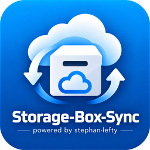

[Änderungsprotokoll](CHANGELOG.md) | [Releases](https://github.com/Stephan-Lefty/storage-box-sync/releases) | [TODO](TODO.md) | [🇬🇧 English](README.en.md)

<p align="center">
  
</p>

# storage-box-sync

Hält einen Ordner auf dem Rechner und eine **Hetzner Storage Box** in beide
Richtungen abgeglichen – und damit auch mehrere Rechner untereinander.
Läuft unter Linux, Windows und macOS. Oberfläche und Meldungen sind deutsch.

```
PC Manjaro  ⇄  Storage Box  ⇄  PC Windows
                    ⇅
                 Notebook
```

Unter der Haube arbeitet [rclone bisync](https://rclone.org/bisync/) über SFTP.
`storage-box-sync` nimmt ihm die mühsamen Teile ab: Einrichtung, Schutz vor
Datenverlust, Sperren zwischen mehreren Rechnern, Zeitplan auf drei
Betriebssystemen und eine Oberfläche, die man auch ohne Kommandozeile bedienen
kann.

## Was es kann

* **Zweiweg-Abgleich.** Jeder Rechner darf anlegen, ändern, umbenennen und
  löschen. Die Storage Box ist die Mitte.
* **Konflikte werden behandelt, nicht verschwiegen.** Wurde dieselbe Datei auf
  zwei Rechnern geändert, gewinnt standardmäßig die neuere Fassung; die
  unterlegene bleibt als `Brief.konflikt-manjaro-pc.odt` liegen. Nichts
  verschwindet still.
* **Schutz vor dem schlimmen Fall.** Ist das Laufwerk nicht eingehängt, sieht
  der Ordner leer aus – ein naiver Spiegel würde daraufhin die Box leeren.
  Dagegen stehen drei Riegel: Prüfdatei auf beiden Seiten, Löschgrenze in
  Prozent, und ein Probelauf, der nichts anfasst.
* **Mehrere Rechner ohne Gerangel.** Vor jedem Lauf legt der Rechner eine
  Sperrdatei auf der Box ab. Findet er eine fremde, frische Sperre, wartet er
  bis zum nächsten Durchlauf.
* **Automatisch.** Beim Start des Rechners und stündlich – über systemd
  (Linux), die Aufgabenplanung (Windows) oder launchd (macOS).
* **Rücksicht auf die Storage Box.** Hetzner erlaubt **zehn Verbindungen
  gleichzeitig** über alle Protokolle zusammen. Die Vorgabe von vier
  Übertragungen lässt Luft für Backups und andere Zugriffe.

## Voraussetzungen

* Python 3.9 oder neuer
* **rclone 1.66 oder neuer** (`--conflict-resolve` gibt es erst ab 1.66;
  mit 1.67+ ist auch der Grundlauf klüger)
* eine Hetzner Storage Box mit aktiviertem SSH-Zugang
* für die Oberfläche: PyQt6 (freiwillig)

## Installation

### Linux und macOS

```bash
# rclone zuerst
pamac install rclone            # Manjaro, Arch
sudo apt install rclone         # Debian, Ubuntu
brew install rclone             # macOS

# dann das Tool, am saubersten mit pipx
pipx install "git+https://github.com/Stephan-Lefty/storage-box-sync.git[fenster]"

# oder ohne pipx
pip install --user "git+https://github.com/Stephan-Lefty/storage-box-sync.git[fenster]"
```

Auf Arch und Manjaro ist PyQt6 über die Paketverwaltung besser aufgehoben als
über pip:

```bash
pamac install python-pyqt6
pipx install --system-site-packages git+https://github.com/Stephan-Lefty/storage-box-sync.git
```

Im Ordner `packaging/` liegt eine `PKGBUILD` für ein eigenes Arch-Paket.

### Windows

```powershell
winget install Rclone.Rclone
winget install Python.Python.3.12

pip install "git+https://github.com/Stephan-Lefty/storage-box-sync.git[fenster]"
```

Danach stehen `storage-box-sync` (Kommandozeile),
`storage-box-sync-fenster` und `storage-box-sync-symbol` (ohne Konsolenfenster)
zur Verfügung.

### Aus dem geklonten Quellcode

```bash
git clone https://github.com/Stephan-Lefty/storage-box-sync.git
cd storage-box-sync
pip install -e ".[fenster,entwicklung]"
pytest
```

## Einrichten

Mit Fenster:

```bash
storage-box-sync fenster
```

Oder im Dialog auf der Kommandozeile:

```bash
storage-box-sync einrichten
```

Gefragt wird nach:

| Angabe | Beispiel | Bemerkung |
|---|---|---|
| Örtlicher Ordner | `/mnt/raid/Stephan-Storage-Box` | muss vorhanden sein |
| Server | `u123456.your-storagebox.de` | aus der Hetzner-Konsole |
| Benutzer | `u123456` oder `u123456-sub1` | Unterkonten gehen auch |
| Port | `23` | schneller SSH-Dienst; `22` ist immer offen |
| Ordner auf der Box | `/` oder `/daten` | wird angelegt, wenn er fehlt |

Dann einmalig der **Grundlauf**. Er vergleicht beide Seiten vollständig und
bringt sie in Einklang – bei Dateien, die es auf beiden Seiten gibt, gewinnt
die neuere. Gelöscht wird dabei nichts.

```bash
storage-box-sync grundlauf --probelauf    # erst nur anzeigen
storage-box-sync grundlauf                # dann wirklich
```

Ab jetzt reicht:

```bash
storage-box-sync abgleich
```

## Zweiter und dritter Rechner

Auf jedem weiteren Rechner dasselbe – mit zwei Dingen, auf die es ankommt:

1. **Derselbe Ordner auf der Box.** Sonst gleichen die Rechner verschiedene
   Bestände ab.
2. **Ein eigener Rechnername.** Er steckt in den Sperrdateien und in den Namen
   der Konfliktdateien, also sollte er sprechen: `manjaro-pc`, `windows-buero`,
   `notebook`.

```bash
storage-box-sync einrichten --rechnername windows-buero
storage-box-sync grundlauf
```

Der Grundlauf auf dem zweiten Rechner holt alles von der Box, was dort liegt,
und schickt alles hoch, was nur örtlich vorhanden ist.

## Automatischer Lauf

```bash
storage-box-sync zeitplan ein       # beim Start und stündlich
storage-box-sync zeitplan status
storage-box-sync zeitplan aus
```

Was dabei angelegt wird:

* **Linux:** `~/.config/systemd/user/storage-box-sync.{service,timer}` mit
  `OnBootSec=3min`, `OnUnitActiveSec=1h`, `Persistent=true` und
  `RequiresMountsFor=<Ordner>`. Soll der Abgleich auch ohne angemeldete Sitzung
  laufen: `sudo loginctl enable-linger $USER`.
* **Windows:** zwei Aufgaben in der Aufgabenplanung – eine bei der Anmeldung
  (drei Minuten Vorlauf), eine stündlich.
* **macOS:** ein LaunchAgent mit `RunAtLoad` und `StartInterval 3600`.

Mehrere Rechner stören sich dabei nicht: die Zeitpläne sind leicht versetzt,
und die Sperre auf der Box fängt den Rest ab.

## Symbol in der Kontrollleiste

```bash
storage-box-sync symbol
```

| Farbe | Bedeutung |
|---|---|
| grün | letzter Abgleich erfolgreich |
| blau | Abgleich läuft gerade |
| gelb | seit über 26 Stunden kein Abgleich |
| rot | letzter Lauf fehlgeschlagen oder Laufwerk nicht eingehängt |

Linksklick öffnet den Ordner. Rechtsklick führt zu Abgleich, Einstellungen,
Einzelheiten und Protokoll.

Automatisch mitstarten:

* **Linux (KDE, GNOME, XFCE):** `packaging/storage-box-sync-symbol.desktop`
  nach `~/.config/autostart/` kopieren.
* **Windows:** Verknüpfung auf `storage-box-sync-symbol.exe` in
  `shell:startup` legen.

## Alle Befehle

| Befehl | Zweck |
|---|---|
| `einrichten` | Zugang, Ordner und Zeitplan festlegen |
| `pruefen` | Verbindung, Ordner, Prüfdatei und Sperren ansehen |
| `grundlauf` | erster vollständiger Abgleich |
| `abgleich` | Änderungen in beide Richtungen übertragen |
| `status` | Zustand in Kurzform (gut, veraltet, fehler …) |
| `protokoll` | letztes Protokoll anzeigen, `--liste` für alle |
| `zeitplan ein\|aus\|status` | automatischen Lauf steuern |
| `sperren` | Sperren auf der Box ansehen, `--loesen` zum Aufräumen |
| `ordner` | örtlichen Ordner im Dateimanager öffnen |
| `fenster` / `symbol` | Oberfläche starten |
| `info` | Pfade, Versionen, Zeitplanbefehl |

`--probelauf` zeigt bei `grundlauf` und `abgleich`, was geschehen würde, ohne
etwas zu verändern. `--still` schreibt nur ins Protokoll – das nutzt der
Zeitplan.

## Wo liegt was

| | Linux | Windows |
|---|---|---|
| Einstellungen | `~/.config/storage-box-sync/einstellungen.json` | `%APPDATA%\storage-box-sync\` |
| Ausnahmen | `…/ausnahmen.txt` | ebenda |
| rclone-Zugang | `…/rclone.conf` | ebenda |
| Dateilisten | `~/.local/state/storage-box-sync/bisync/` | `%LOCALAPPDATA%\storage-box-sync\bisync\` |
| Protokolle | `~/.local/state/storage-box-sync/protokolle/` | `%LOCALAPPDATA%\storage-box-sync\protokolle\` |

Die eigene `rclone.conf` liegt mit Absicht getrennt: eine vorhandene
rclone-Einrichtung des Benutzers wird nicht angefasst.

## Sicherheit und Grenzen – offen gesagt

* **Das Passwort ist verschleiert, nicht verschlüsselt.** `rclone obscure`
  lässt sich zurückrechnen. Unter Linux liegt die Datei mit Rechten `600` im
  eigenen Konto, unter Windows im Benutzerprofil. Wer mehr braucht, legt einen
  SSH-Schlüssel an und trägt ihn als Schlüsseldatei ein – dann steht kein
  Passwort in der Datei.
* **Die Fernsperre ist gut, aber nicht lückenlos.** SFTP kennt kein atomares
  „nur anlegen, wenn nicht vorhanden“. Zwei Rechner, die in derselben Sekunde
  starten, könnten beide eine Sperre schreiben; dafür gibt es einen zweiten
  Blick und eine feste Vorrangregel. Ganz ausschließen lässt sich das Rennen
  nicht. In der Praxis hilft, dass die Zeitpläne versetzt laufen.
* **Zweiweg-Abgleich ist kein Backup.** Wer auf einem Rechner löscht, löscht
  überall. Die Storage Box kann Momentaufnahmen anlegen – das ist das Netz
  darunter, und es kostet Platz, denn Momentaufnahmen zählen zum belegten
  Speicher.
* **Ausnahmen ändern heißt neu grundieren.** Nach einer Änderung an
  `ausnahmen.txt` verlangt rclone einen neuen Grundlauf.

## Wenn etwas klemmt

**„Die Prüfdatei RCLONE_TEST fehlt“** – genau dafür ist sie da. Das Laufwerk
ist nicht eingehängt, oder die Datei wurde gelöscht. Einhängen, dann
`storage-box-sync pruefen`.

**„Ein anderer Rechner gleicht gerade ab“** – normal, der Lauf wird
übersprungen und beim nächsten Mal nachgeholt. Hängt eine Sperre fest, hilft
`storage-box-sync sperren` und `--loesen`.

**rclone bricht mit „must run --resync“ ab** – die Dateilisten passen nicht
mehr, etwa nach einem Abbruch oder einer Änderung an den Ausnahmen.
`storage-box-sync grundlauf` setzt neu auf.

**Verbindungsfehler oder Zeitüberschreitungen** – vermutlich sind die zehn
Verbindungen der Storage Box aufgebraucht. Andere Zugriffe prüfen
(Nextcloud-Einbindung, Backups, offene SFTP-Sitzungen) und die Zahl der
Übertragungen senken.

**Konfliktdateien stapeln sich** – zwei Rechner bearbeiten dieselben Dateien.
Entweder öfter abgleichen oder die Arbeit sauberer trennen.

## Mitarbeit

```bash
pip install -e ".[fenster,entwicklung]"
pytest
```

Die Tests brauchen kein rclone und keine Storage Box: in `tests/attrappen/`
liegt eine Attrappe, die rclone nachstellt und alle Aufrufe mitschreibt.

## Lizenz

MIT – siehe [LICENSE](LICENSE).
